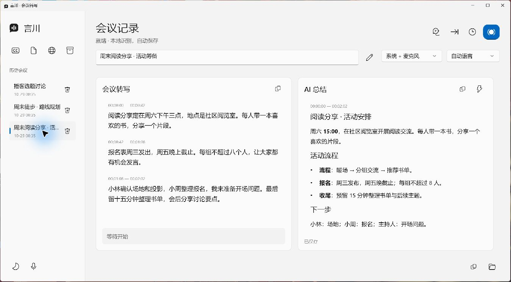
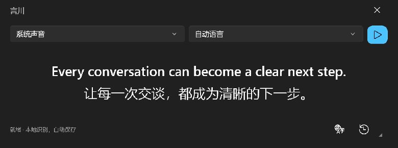
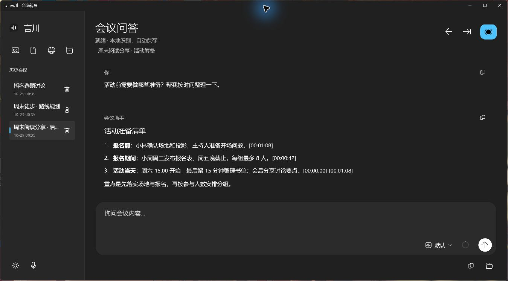

# 言川 · YanChuan

**把声音写下来，让讨论有迹可循。**

言川是一款面向 Windows 的实时字幕与会议记录工具：听取电脑声音或麦克风音频，生成字幕和转写，再通过 AI 翻译、总结与问答整理内容。适合观看外语视频、记录线上会议，以及回顾课程和访谈。

语音识别在本机运行。启用 AI 翻译、总结或问答后，相应文字会发送给你配置的模型服务。



*以下界面截图均使用虚构示例内容。*

## 功能介绍

| 功能 | 可以做什么 |
| --- | --- |
| 实时语音转文字 | 支持中文、日语、英语和自动语言识别；可采集系统声音、麦克风，或同时采集两者。 |
| 桌面悬浮字幕 | 窗口始终置顶，默认显示两行，支持按语义拆分短字幕和展开历史；鼠标移出时自动隐藏背景。 |
| 字幕自动翻译 | 可选择中文、日语或英语，支持仅原文、上下双语和仅译文三种显示方式。 |
| 会议转写 | 为内容添加时间戳，自动保存到本地；支持会议改名、历史回看、完整复制和删除。 |
| 长录音导入 | 导入 WAV、FLAC 文件，分段识别长音频并保存结果。 |
| AI 会议总结 | 支持手动总结和定时总结，可创建、编辑和切换多套提示词模板。 |
| 会议问答 | 结合会议全文与聊天记录多轮提问；独立选择模型和思考强度，查看上下文用量。 |
| 内容排版 | 总结与问答支持 Markdown，包括标题、列表、表格、代码块、行内公式和独立公式。 |
| 多服务配置 | 支持 Chat Completions、Responses、Anthropic Messages，可保存多个 API 配置并获取模型列表。 |
| 深浅主题 | 原生 Windows 界面，支持浅色和深色模式。 |

**桌面双语字幕**



**会议问答 · 深色模式**



## 安装部署

### 安装版

适合直接使用，不需要安装 Python、.NET 或 Visual Studio。

1. 获取发布附件中的 `YanChuan-<版本>-Setup-x64.exe`。
2. 运行安装程序，选择安装目录及是否创建桌面快捷方式。
3. 打开“言川”，按下面的步骤下载识别模型并选择音源。

更新版本时先退出正在运行的应用，再执行新安装包。已有会议、API 配置和模型路径会继续沿用。

### 便携版

获取 `YanChuan-<版本>-win-x64.zip`，完整解压后运行 `YanChuan.exe`。便携版同样将配置和会议保存到用户数据目录，方便更换程序目录或更新版本。

### 运行要求

- Windows 10 1809 及以上的 64 位系统。
- 默认使用 Vulkan GPU 加速，需要支持 Vulkan 的显卡及驱动。
- 安装包不含模型，首次下载模型需要联网；模型准备好后可在本地转写。
- AI 翻译、总结和问答需要另行配置可用的模型服务。

### 从源码运行

开发环境需要 **Python 3.12、uv、.NET SDK 10，以及包含 WinUI 应用开发工作负载的 Visual Studio 2026**。

在仓库根目录执行：

```powershell
uv sync
uv sync --project apps/desktop-backend
powershell -ExecutionPolicy Bypass -File .\start.ps1
```

启动脚本会构建 WinUI 应用并自动启动后台进程。各 Python 项目使用各自的 `.venv`。

Git 源码不包含原生 DLL。进行真实识别前，需要准备兼容的 CrispASR Vulkan 运行库到 `runtime/native/win-x64/`；可从已发布便携包的 `backend/native/` 复制，或按[原生构建说明](experiments/native-qwen/README.md)自行构建。识别模型通过应用单独下载。

## 配置与使用

### 1. 准备识别模型

点击左侧的模型图标，选择模型与存放目录，下载识别模型和分段模型。也可以选择已有的兼容 GGUF 文件。

目前提供 **Qwen3-ASR 0.6B Q8** 和 **1.7B Q8**：0.6B 资源占用较低，1.7B 需要更多内存与显存。默认使用 0.6B。

### 2. 选择声音来源

在主窗口选择“系统声音”“麦克风”或“系统 + 麦克风”，再选择识别语言。需要指定具体设备时，点击左下角的音频设备图标。

- 观看视频或记录电脑播放的内容：选择系统声音。
- 记录自己讲话：选择麦克风。
- 同时记录线上会议与自己的发言：选择系统声音和麦克风。

### 3. 使用实时字幕

点击左侧字幕图标打开悬浮窗，再点击播放图标开始识别。

字幕默认居中显示最近两行。鼠标移入可显示控件，移出后背景自动透明；点击历史图标向上查看过往字幕。展开历史时背景保持显示。

需要翻译时，点击字幕窗中的翻译图标，启用自动翻译，选择目标语言、显示方式和所用服务。

### 4. 记录会议与导入录音

填写会议名称、选择音源和语言后，点击右上角录制图标开始。再次点击停止，应用会保存尾段内容。已有录音可通过导入图标选择 WAV 或 FLAC 文件。

转写按时间戳保存，左侧历史列表可重新打开会议。铅笔图标保存新名称，复制图标复制全部内容，垃圾桶图标在确认后删除对应会议及其转写、总结和问答。

会议、录音导入和独立字幕一次运行一种转写任务，切换前先停止当前任务。

### 5. 配置 AI 服务

点击左侧 API 配置图标，新建配置并填写：

| 配置项 | 填写内容 |
| --- | --- |
| 协议 | 根据服务选择 Chat Completions、Responses 或 Anthropic Messages。 |
| API 地址 | 服务商或自建服务提供的地址。 |
| API 密钥 | 对应服务的访问密钥。 |
| 模型 | 输入模型 ID，或点击获取模型列表后选择。 |

保存并使用后，即可进行总结。提示词模板入口支持新建、复制、编辑和切换模板。

点击主窗口的时钟图标设置自动总结，默认每 **5 分钟**一次，可调整为 **1–120 分钟**；总结区域的灯泡图标可随时手动总结。

点击右上角对话图标进入会议问答。输入区底部的“默认”菜单统一选择模型与思考强度；上下文圆环可查看用量，点击后调整容量。**Ctrl + Enter 发送，Enter 换行**。思考强度的可用档位由具体模型服务决定。

### 数据保存位置

全新安装默认保存在 `%LOCALAPPDATA%\YanChuan`，会议与配置位于其中的 `data/`，模型默认位于 `models/`；模型也可以指定其他目录。已有旧版数据目录时会继续使用原位置。

会议记录以 SQLite 保存，同时生成可阅读的 Markdown 导出。主窗口底部的文件夹图标可打开当前会议目录。更多操作见[桌面使用说明](apps/desktop-winui/README.md)。

## 参与贡献

欢迎提交使用反馈、Bug 报告、功能建议和 Pull Request。

### 反馈问题

提交 Issue 时请附上应用版本、Windows 版本、显卡型号、声音来源、复现步骤，以及预期和实际结果。界面问题可以附截图；识别问题可提供适合公开的短音频与参考文字。

分享日志或示例前，请去掉 API 密钥、私人服务地址、会议隐私和个人路径。

### 提交改动

1. Fork 仓库并创建功能分支。较大的功能或结构调整先通过 Issue 讨论。
2. 按“从源码运行”准备环境，完成改动并运行相关模块的测试。
3. 提交 PR，说明解决的问题、改动内容及验证方式；界面改动附效果截图。

项目采用 **C# / WinUI 3 前端 + Python 后端**，识别、采集、翻译和会议功能分别作为独立模块维护。改动时保持现有依赖方向，界面通过客户端访问后端。

| 位置 | 主要职责 |
| --- | --- |
| `apps/desktop-winui/` | Windows 主窗口与字幕悬浮窗。 |
| `apps/desktop-backend/` | 本地后台进程通信。 |
| `src/livecaptions_asr/` | 语音识别、音频解码与分段 API。 |
| `packages/` | 音频采集、会议保存、AI 服务、翻译和桌面服务。 |
| `tests/`、各模块的 `tests/` | 测试。 |
| `docs/`、`examples/` | 接口说明与组合示例。 
开发细节可查阅[项目约定](AGENTS.md)、[架构说明](docs/decoupling.md)、[Python API](docs/python-api.md)和[桌面进程接口](docs/desktop-api.md)。安装包构建见[安装版说明](installer/README.md)，公开源码范围见[发布准备说明](docs/publication.md)。
